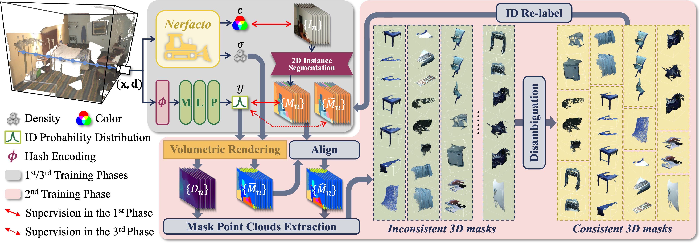

[](https://opensource.org/licenses/Apache-2.0)
[](https://pytorch.org/)

This repo contains the official implementation of the **Information Fusion (INFFUS) 2025** paper.

<div align="center">
<h1>
<b>
Cues3D: Unleashing the Power of Sole NeRF for Consistent and Unique Instances in Open-Vocabulary 3D Panoptic Segmentation 
</b>
</h1>
<h4>
<b>
Feng Xue, Wenzhuang Xu, Guofeng Zhong, Anlong Ming, Nicu Sebe
</b>

<b>
Beijing University of Posts and Telecommunications (BUPT)

University of Trento (UNITN)
</b>
</h4>
</div>


## Cues3D

This repository provides the implementation of Cues3D in PyTorch.
The network structure of Cues3D is shown as follows:

<p align="center">

</p>

## 📖Catalogue

* <a href='#Pre-Processing'>1. Pre-Processing</a>
* <a href='#Installation'>2. Installation of Cues3D</a>
* <a href='#Try Cues3D on a Sample in Three Stages'>3. Try Cues3D on a Sample in Three Stages</a>
* <a href='#citation'>4. Citation</a>
* <a href='#thanks'>5. Thanks</a>


<span id='Pre-Processing'/>

## Pre-Processing <a href='#all_catelogue'>[Back to Catalogue]</a>

***We have prepared a sample that you can download and run Cues3D directly. Download [the file](https://drive.google.com/file/d/1g4z6uuvZIIWjawYIMQTt7oOutvbKfZlw/view?usp=sharing) and put it in `./data`.***

[Follow these instructions](https://github.com/qqlu/Entity/blob/main/Entityv2/README.md) to create another environment and install **CropFormer** dependencies.
Then, use **CropFormer** to obtain the instance segmentation save in `./data/$dataset_name/$scene_name/cropformer` and aggregate all segmentations into a `outputs/$scene_name/instances.npy` file using the following command.

```bash
python utils/process_cropformer_result.py
```


<span id='Installation'/>

## Installation of Cues3D <a href='#all_catelogue'>[Back to Catalogue]</a>

### 0. NeRFStudio Dependencies
[Follow these instructions](https://github.com/nerfstudio-project/nerfstudio/tree/main#quickstart) to install nerfstudio dependencies and create an environment

### 1. Install This Repo as a Python Package
Navigate to this folder and run `python -m pip install -e .`
And then run `pip install tyro==0.8.2`

### 2. Run `ns-install-cli`

### 3. Checking the Installation
Run `ns-train -h`: you should see a list of "subcommands" with cues3d included among them.

<span id='Try'/>

## Try Cues3D on a Sample in Three Stages <a href='#all_catelogue'>[Back to Catalogue]</a>

```bash
# Before the first stage, ensure 'predict_split = "train"' in 'cues3d/cues3d_config.py'.
bash run_first_stage.sh
bash run_second_stage.sh

# Before the third stage, ensure 'predict_split = "eval"' in 'cues3d/cues3d_config.py'.
bash run_third_stage.sh

# Semantic segmentation
bash semantic_seg.sh

# Evaluation
bash eval.sh

# all result save in ./outputs.
```

Note that in the **first** and **third** stages, new folders will be created in the ```/output``` directory. When running ```eval.sh```, a point cloud npy file will be created in the ```/pred_pointcloud``` directory.


Finally, you will get a result of the sample:

```
evaluating:pred_pointcloud/scene0050_02.npy gt_pointcloud/scene0050_02.txt

################################################################
what           :            AP           AP_50%         AP_25%
################################################################
everything     :          0.215          0.531          0.725
----------------------------------------------------------------
average        :          0.215          0.531          0.725
```


<span id='citation'/>

## Citation: <a href='#all_catelogue'>[Back to Catalogue]</a>
```
@article{INFFUS_2025,
    title = {Cues3D: Unleashing the power of sole NeRF for consistent and unique instances in open-vocabulary 3D panoptic segmentation},
    journal = {Information Fusion},
    volume = {122},
    pages = {103164},
    year = {2025},
    issn = {1566-2535},
    author = {Feng Xue and Wenzhuang Xu and Guofeng Zhong and Anlong Ming and Nicu Sebe}
}
```

<span id='thanks'/>

## Thanks: <a href='#all_catelogue'>[Back to Catalogue]</a>

Our repo is built on [NeRFStudio](https://docs.nerf.studio/) and uses methods such as [CropFormer](https://github.com/qqlu/Entity), [FC-CLIP](https://github.com/bytedance/fc-clip), and [CLIP](https://github.com/openai/CLIP), thanks their clear and elegant code !